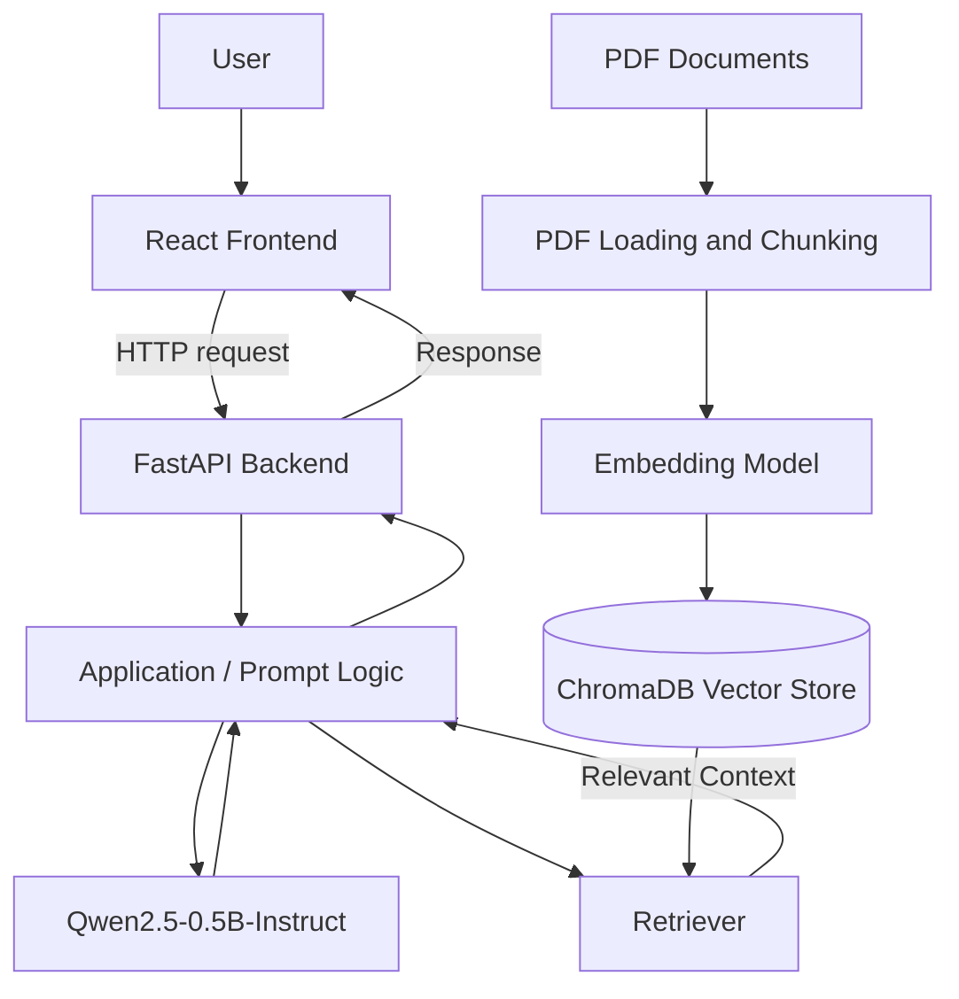

# GenAI Chat Application

### A Retrieval-Augmented Generation (RAG) chatbot powered by Qwen2.5, FastAPI, React, and LangChain

Ask questions, retrieve relevant information from PDF documents, and generate responses with a lightweight instruction-tuned language model.

[](https://www.python.org/)
[](https://fastapi.tiangolo.com/)
[](https://react.dev/)
[](https://huggingface.co/Qwen/Qwen2.5-0.5B-Instruct)
[](https://www.langchain.com/)

</div>

---

## Table of Contents

- [Overview](#overview)
- [Key Features](#key-features)
- [Technology Stack](#technology-stack)
- [How It Works](#how-it-works)
- [Architecture](#architecture)
- [Project Structure](#project-structure)
- [Prerequisites](#prerequisites)
- [Model Configuration](#model-configuration)
- [RAG Pipeline](#rag-pipeline)
- [API Documentation](#api-documentation)
- [Docker](#docker)
- [Deployment Considerations](#deployment-considerations)
- [Troubleshooting](#troubleshooting)
- [Security and Git Hygiene](#security-and-git-hygiene)
- [Roadmap](#roadmap)
- [Contributing](#contributing)
- [License](#license)

## Overview

**GenAI Chat Application** is a full-stack conversational AI project that combines a web-based chat interface with a Python API and a language-model inference pipeline. It is designed to support general prompts and, where the RAG workflow is configured, questions grounded in the content of PDF documents.

The application uses **Qwen/Qwen2.5-0.5B-Instruct** for text generation. For document-based question answering, the RAG workflow can retrieve relevant text chunks from a ChromaDB vector store and pass that context to the model.

The project brings together frontend development, API engineering, language-model integration, semantic search, and document processing in one application.

> **Implementation note:** This README documents the intended stack and workflow. Confirm file paths, endpoint names, request schemas, and optional Docker support against the current repository before publishing them as guaranteed functionality.

## Key Features

- **Conversational interface:** Submit prompts through a React-based web frontend.
- **FastAPI backend:** Expose the application's functionality through a Python API.
- **Instruction-tuned LLM:** Generate text with `Qwen/Qwen2.5-0.5B-Instruct`.
- **LangChain integration:** Wrap and invoke the Hugging Face text-generation pipeline.
- **PDF-based RAG:** Extract and split document text into smaller passages for retrieval.
- **Semantic embeddings:** Represent text using Sentence Transformers, such as `all-MiniLM-L6-v2`, if configured in the current pipeline.
- **Vector search:** Store and retrieve document chunks through ChromaDB.
- **Interactive API docs:** Inspect available routes and schemas through FastAPI's Swagger UI.
- **Containerization:** Docker can be used if the repository contains a compatible Dockerfile or Compose configuration.

## Technology Stack

| Component | Technology | Purpose |
|---|---|---|
| Frontend | React, JavaScript, Vite | Chat user interface and development server |
| HTTP client | Axios, if used by the frontend | Send requests to the backend API |
| Backend | Python, FastAPI | API endpoints and request handling |
| ASGI server | Uvicorn | Run the FastAPI application |
| Language model | Qwen/Qwen2.5-0.5B-Instruct | Instruction-following text generation |
| Model runtime | Hugging Face Transformers, PyTorch | Load the model and run inference |
| LLM orchestration | LangChain, `langchain-huggingface` | Integrate the model with application logic |
| Embeddings | Sentence Transformers | Convert text into vector representations |
| Vector database | ChromaDB | Store and retrieve embedded document chunks |
| Document processing | PDF loader and text splitter configured in the project | Prepare source documents for retrieval |
| Containerization | Docker, optional | Package application services |

## How It Works

### General chat flow

1. A user enters a prompt in the React interface.
2. The frontend sends the request to the FastAPI backend.
3. The backend passes the prompt to the configured language-model pipeline.
4. Qwen2.5-0.5B-Instruct generates a response.
5. The backend returns the response to the frontend for display.

### Document question-answering flow

1. PDF files are loaded and their text is extracted.
2. Extracted text is divided into manageable chunks.
3. An embedding model converts the chunks into vectors.
4. The chunks and vectors are stored in ChromaDB.
5. A user's question is embedded or otherwise processed for retrieval.
6. The vector store returns relevant document chunks.
7. The application combines the question with retrieved context and sends it to the language model.
8. The generated answer is returned to the user.

RAG can help ground answers in supplied documents, but it does not guarantee correctness. Answer quality depends on document extraction, chunking, retrieval configuration, prompt design, and model behavior.

## Architecture



*The diagram represents the intended logical workflow. Adjust it if the implemented code uses a different sequence or separate services.*

## Project Structure

The tree below is a guide based on the project layout discussed during development. Verify names and locations against the actual repository.

```text
GenAI_ChatboT-01/
|── Images
|── Public
├── backend/
│   ├── RAG/
│   │   └── rag.py
│   ├── llm/
│   │   └── model.py
│   ├── data/
│   │   └── pdfs/                 # Source PDFs, if included
│   ├── intergrate_llm.py         # Existing filename; consider renaming consistently
│   ├── main.py                   # FastAPI application entry point
├── src/
├── package.json
└── vite.config.js
├── .gitignore
├── Dockerfile                    # Optional; include only if present
|── requirements.txt          # Python dependencies, if stored here
└── README.md
```

Generated vector-store files, virtual environments, caches, and local secrets should not be committed. The PDF folder should contain only documents you have permission to distribute.

## Prerequisites

- Python version supported by the project's dependencies.
- Node.js and npm for the React/Vite frontend.
- Git.
- Internet access for initial model and dependency downloads.
- Sufficient RAM and disk space for PyTorch, Transformers, the language model, and the embedding model.

Because package compatibility can vary by operating system and Python version, use a clean virtual environment and install the versions specified by the project's dependency file.


### 2. Start the backend

From the directory containing `main.py`, use the command matching your application setup:

```bash
uvicorn main:app --reload
```

Alternatively, if the FastAPI CLI is installed and configured for this project:

```bash
fastapi dev main.py
```

The default local API documentation is usually available at:

- Swagger UI: `http://127.0.0.1:8000/docs`
- OpenAPI schema: `http://127.0.0.1:8000/openapi.json`

The actual port depends on the command and configuration you use.

### 3. Start the frontend

Open another terminal at the repository root:

```bash
cd frontend
npm install
npm run dev
```

Open the local URL printed by Vite, commonly `http://localhost:5173`.

Make sure the frontend's API base URL points to the backend you are running. Configure CORS on FastAPI for the frontend origin if browser requests are being blocked.

## Model Configuration

The application model is:

**[`Qwen/Qwen2.5-0.5B-Instruct`](https://huggingface.co/Qwen/Qwen2.5-0.5B-Instruct)**

It is an instruction-tuned model in the Qwen2.5 family. The example below shows a typical Transformers and LangChain integration. Adapt it to match the current `backend/llm/model.py` implementation.

```python
from transformers import pipeline
from langchain_huggingface import HuggingFacePipeline

def general_purpose_model():
    text_generation_pipeline = pipeline(
        task="text-generation",
        model="Qwen/Qwen2.5-0.5B-Instruct",
        max_new_tokens=256,
        do_sample=False,
        device="auto",
        return_full_text=False,
    )

    return HuggingFacePipeline(
        pipeline=text_generation_pipeline
    )
```

### Performance notes

- The model is downloaded from Hugging Face the first time it is loaded unless a local cache is available.
- CPU inference can work without a dedicated GPU but may be slower.
- A model's parameter count does not equal its total runtime memory requirement. PyTorch, model weights, tokenizers, activations, and other loaded components use additional memory.
- RAG adds its own memory and startup costs, especially when loading an embedding model and initializing the vector store.
- `max_new_tokens` controls the maximum number of new tokens generated; reducing it can help limit generation work, but it does not eliminate model-loading memory requirements.
- Do not load the model separately for every request. Prefer a shared model instance managed by the application lifecycle.

## RAG Pipeline

The RAG component is intended to improve document-based responses by retrieving relevant passages before generation.

### Main stages

| Stage | Description |
|---|---|
| Document ingestion | Load text from configured PDF files |
| Text splitting | Divide long documents into smaller overlapping chunks |
| Embedding generation | Convert chunks to vector representations |
| Vector storage | Persist or index vectors and their associated text in ChromaDB |
| Retrieval | Find chunks relevant to a user query |
| Context construction | Format retrieved text with the user's question |
| Answer generation | Ask Qwen2.5-0.5B-Instruct to respond using the supplied context |

### Practical recommendations

- Use the same embedding model and compatible preprocessing during indexing and retrieval.
- Keep chunk sizes and overlap appropriate for the source documents.
- Handle empty PDFs, extraction failures, and missing data directories.
- Avoid indexing the same documents repeatedly on every application restart.
- Ensure the configured ChromaDB path is consistent between document ingestion and retrieval.
- Consider returning source filenames or page references so users can inspect supporting passages.
- Do not assume that a high similarity score proves that a retrieved passage answers the question.

## API Documentation

FastAPI can provide interactive documentation at `/docs` when the server is running.

Use the generated OpenAPI documentation to confirm:

- Available route paths and HTTP methods.
- Required request fields and their data types.
- Response fields and error formats.
- Whether the endpoint supports general chat, document queries, or both.

The exact chat endpoint and JSON schema are intentionally not hard-coded here because they must match the current implementation. Test a request through Swagger UI before documenting an example `curl` command.

## Docker

Docker instructions depend on whether the repository contains a valid Dockerfile or Compose configuration. If a Dockerfile is present in the current directory, a typical build command is:

```bash
docker build -t genai-chat-app .
```

Run the container only with the port and startup command expected by that Dockerfile. For example, a backend configured to listen on port 8000 might be run with:

```bash
docker run --rm -p 8000:8000 genai-chat-app
```

This example is not a substitute for checking the actual Dockerfile. A full-stack deployment may require separate frontend and backend services, environment variables, persistent storage, and appropriate networking.

## Deployment Considerations

Before deploying, verify the following:

- **Memory:** Confirm the host has enough RAM for the language model, PyTorch, embedding model, and API process.
- **Startup time:** Model downloads and initialization can exceed free-tier startup or request limits.
- **Persistent storage:** Ephemeral filesystems may lose locally stored vector databases or model caches after restarts.
- **CORS:** Allow only the frontend origins you intend to support.
- **Configuration:** Use environment variables for deployment-specific URLs and settings.
- **Model serving:** If the host cannot run local inference within its memory limit, use a machine with more memory or a remote inference service.
- **Health and logging:** Add health checks and structured logs appropriate for the deployment platform.
- **Testing:** Test both a normal chat request and a document-retrieval request on the deployed service.

## Troubleshooting

| Problem | What to check |
|---|---|
| Model download fails | Check internet access, Hugging Face availability, disk space, and package versions. |
| Model loading runs out of memory | Check RAM usage and loaded models; consider a larger host or remote inference. |
| Backend cannot import a module | Run commands from the expected directory and verify the virtual environment and installed dependencies. |
| Frontend request fails | Check the API base URL, backend availability, browser console, and CORS configuration. |
| RAG finds irrelevant passages | Check PDF text extraction, chunking, embedding consistency, and retrieval settings. |
| Repeated indexing increases startup time | Separate ingestion from API startup or implement an idempotent indexing process. |
| Vector store appears empty after restart | Check the persistence path and whether the hosting filesystem is persistent. |
| Swagger UI does not load | Check the server logs and verify the configured host and port. |

## Security and Git Hygiene

- Never commit `.env` files, access tokens, passwords, or private credentials.
- Do not publish private or copyrighted PDFs unless you have permission.
- Exclude `.venv/`, `__pycache__/`, model caches, logs, generated vector-store data, and build output from Git.
- Validate user input and handle uploaded files safely if file uploads are supported.
- Apply request limits and appropriate authentication before exposing a public API.
- Review CORS rules before production deployment.

## Roadmap

Potential improvements for the project:

- Add source citations or page references to RAG answers.
- Add chat history and conversation management.
- Add tests for API routes, retrieval, and model integration.
- Improve error handling for document ingestion and inference.
- Add configuration for model selection and frontend/backend URLs.
- Add logging, monitoring, and a deployment workflow.
- Add automated checks for code quality and dependency security.

## Contributing

Contributions and suggestions are welcome.

1. Fork the repository.
2. Create a feature branch.
3. Make and test your changes.
4. Submit a pull request with a clear description of the changes.

## License

No license is specified in this README. Add a `LICENSE` file and update this section with the selected license before distributing the project.
'''
